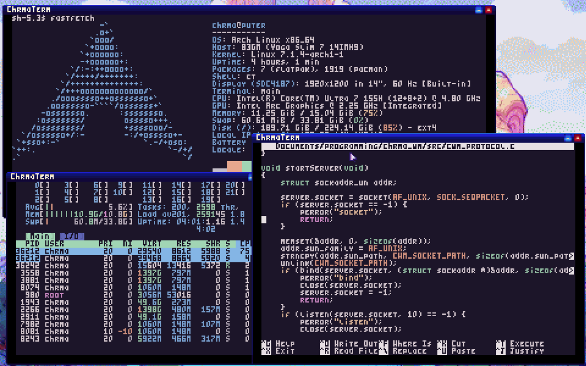

# Chrma WM - A horrible window manager

CWM is a little pet project I made for fun and to see if I could still program by hand and make something that works, this turned out to be a fun learning experience about how linux works!

Most of the code in here is written by me without large use of agents, I also tried to write most of the libraries I would need for this myself, including vectors, loading images, etc. For my sanity I skipped a few things like sockets, low level input handling or going below DRM/KMS, the core and original ct applications were written by me, I also added an ai folder for slop, but technically if you hate yourself enough, just the core and my bad human slop terminal would be enough to bootstrap an entire software stack. :)

At the core, cwm is almost comically minimal, you can probably count the types of protocol messages in your hand, a client requests a window, it requests to draw to it and gets inputs, I believe I also added some stuff for focus and a clipboard but don't remember if I got it working.

I might update this more in the future, feel free to mess and have fun with this!